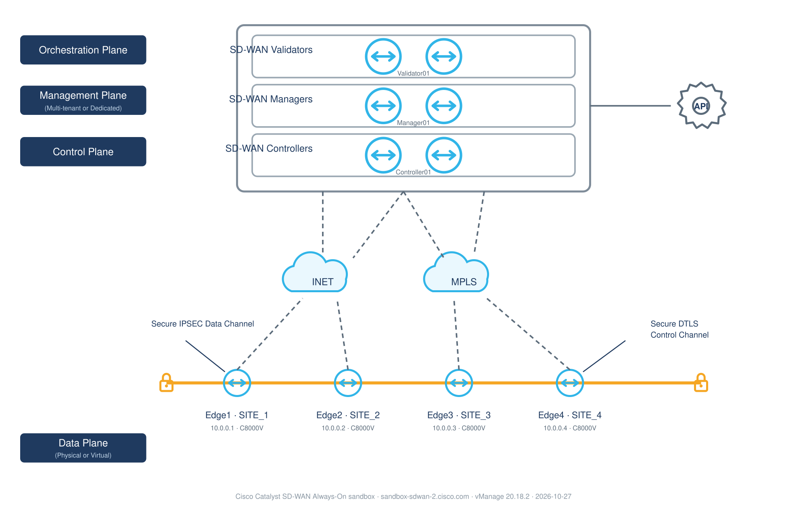
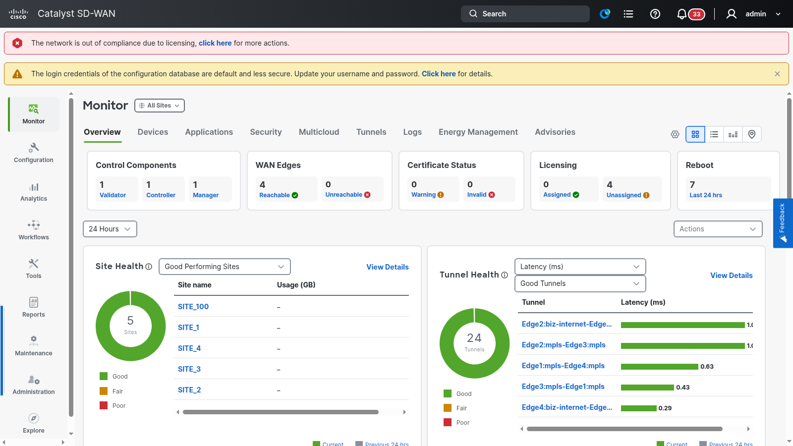
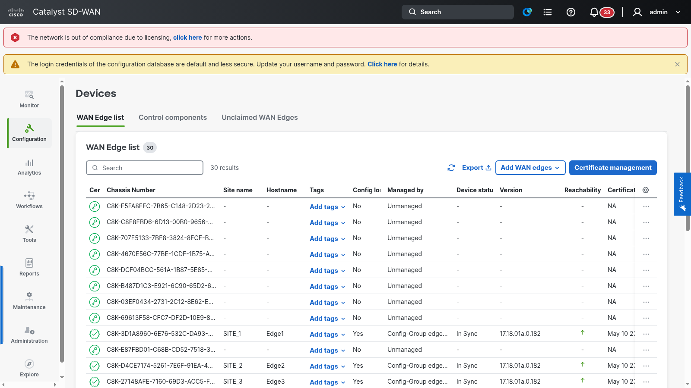

# Automating Cisco Catalyst SD-WAN: A Guided Demo + Field Findings

Two DevNet sandboxes, one goal: drive a real SD-WAN fabric entirely by API — read its
health, write policy, push configuration, and break/repair the overlay while watching
convergence. Everything here was verified live on 2026-10-27 → 10-30.



## The Fabrics

| Host | Role | Site | System-IP | Version |
|---|---|---|---|---|
| Manager01 | vManage (NMS) | 100 | 100.0.0.1 | 20.18.2.1 |
| Controller01 | vSmart (control plane) | 100 | 100.0.0.101 | 20.18.2.1 |
| Validator01 | vBond (orchestration) | 100 | 100.0.0.201 | 20.18.2.1 |
| Edge1–Edge4 | Catalyst 8000V vEdges | 1–4 | 10.0.0.1–4 | 17.18.1a |

A "one site design, four copies" teaching fabric: each edge runs two WAN colors
(`mpls` + `biz-internet`, encap `dia`) and holds 3 DTLS control connections (2× vSmart,
one per color, + 1× vManage). Per-role detail: [`docs/device-breakdown.md`](docs/device-breakdown.md).

---

## Guided Demo

### Act 1 — Read the fabric (always-on sandbox, operator role)
Auth is three lines: `POST /j_security_check` (form creds; failed logins *also* return
200 — check `content-length`), `GET /dataservice/client/token` for CSRF, then
`X-XSRF-TOKEN` on every call. The token **rotates**; cache-and-go breaks mid-run.

```bash
scripts/sdv2.sh GET /dataservice/device          # auto-reauth helper
```

One call to `/dataservice/device` proves the whole overlay: BFD 6/6 up per edge,
OMP up, 3 control connections each, certs valid, zero alarms. Endpoint discovery
trick that unlocked everything else: the SPA's lazy JS chunks carry the complete
client-side endpoint table (recipe in [`docs/api-notes.md`](docs/api-notes.md)).


*Monitor → Overview: 4/4 WAN edges reachable, 24 tunnels good, all sites healthy —
the same picture the API returns.*

### Act 2 — Write policy (admin role, classic policy API)
Created a **hub-and-spoke data policy** end-to-end via
`POST /template/policy/definition/hubandspoke/` — site lists (`Lab-Hub-Sites`,
`Lab-Spoke-Sites`), a VPN list (`Lab-Transit-VPN`), `definition.subDefinitions[]`,
`equalPreference: true`. The payload shape was reverse-engineered from the SPA's
policy chunk (`/tmp/policy.*.js`). Policy writes work on the classic API regardless
of Config Group mode.

### Act 3 — Push configuration (the hard part)
The classic device-template attach (`POST /template/device/config/attachfeature`)
failed for hours with `TemplateException: expecting non-null value for field
'address'`. Two lessons:

1. Don't hand-build the input rows — ask vManage for them:
   `POST /template/device/config/input` returns canonical rows keyed by **config
   paths** (`/1/GigabitEthernet3/interface/ip/address`, not variable display names).
2. Even then, classic attach dies with `vmanage-cfs:templates/... does not exist` —
   **root cause: the sandbox manages every edge with a Config Group** (`edge_basic`,
   "Do not modify!"). Classic-template CFS nodes were never created.


*Configuration → WAN Edge list: the four live edges show `Managed by: Config-Group
edge_basic` and `In Sync` — the line that explains why classic template attach 400s.*

The sanctioned write path (verified end-to-end):

```
GET  /v1/config-group/{cg}/device/variables      # per-device vars
PUT  /v1/config-group/{cg}/device/variables      # {"solution":"sdwan","devices":[...]}
POST /v1/config-group/{cg}/device/deploy         # {"devices":[{"id":uuid}]} → task id
GET  /device/action/status/{taskId}              # "Config applied successfully"
```

### Act 4 — Break it: BFD failover, fully scripted
Fault injection was a Config Group variable change — Edge3's MPLS underlay
(`vpn0_gi2_mpls_ip` 172.16.2.3 → 172.16.99.3, off-subnet = dead transport) + deploy.
Monitoring was one endpoint: `GET /device/bfd/tloc/detail`.

| since fault | what the API shows |
|---|---|
| baseline | 8 TLOCs up, 3 BFD sessions each |
| +30s | **Edge3 mpls row disappears** — a lost TLOC is *row removal*, not a `down` state |
| during fault | Edge3 `biz-internet up/3` (traffic on surviving WAN); all peers' mpls sessions 3→2 — mesh recalculated |
| revert + deploy | Edge3 mpls `up/3` at +40s |
| +180s | **fully recovered**: 8 TLOCs, 3 sessions everywhere, zero manual steps |

---

## Findings (the things that cost hours)

1. **On this sandbox, Config Group is the only write path for edge config.**
   `attachfeature` can never succeed on Config-Group-managed edges; don't fight the
   `global does not exist` CFS error — check `templateApplyLog` on
   `GET /system/device/vedges` first.
2. **`/template/device/config/input` is the attachfeature oracle.** Let the server
   generate variable rows; type hints ride along (e.g. DHCP `address-pool` is
   `ipv4-prefix` → CIDR, not start/end).
3. **Variable PUT is per-device scoped** — sending one device's row doesn't wipe the
   others. Top key is `solution`, not `family` (the GET response lies; it says `family`).
4. **Lost TLOC = missing row** in `bfd/tloc/detail`. Assert on absence, never on
   `state: down`.
5. **vManage sessions idle-timeout in minutes.** Re-auth by driving the SPA login
   *form* (fetch POST to `/j_security_check` returns 200 but doesn't stick).
6. **Role reality:** `devnetuser` = operator = read-only; the reservation page
   publishes `admin` (writes). The always-on sandbox and the on-demand reservation
   differ in exactly this way.
7. **Endpoint archaeology works**: SPA chunks > published docs. `grep -o
   'dataservice/[a-z/{}._-]*'` on the JS bundles found the Config Group and device
   endpoints that the OpenAPI spec (in `docs/rest/`) under-documents.

Full raw findings: [`docs/api-notes.md`](docs/api-notes.md). Raw API evidence (25
dumps incl. the vManage OpenAPI spec): `docs/rest/`. UI walkthrough screenshots:
`docs/shots/`.

## Summary

We read, wrote, broke, and healed a five-node SD-WAN fabric over pure REST:
inventory/health in one call, a hub-and-spoke policy created from scratch, config
pushes through the Config Group API after diagnosing why the classic path was dead,
and a WAN failure injected and repaired by script with ~3 min overlay reconvergence
observed in API telemetry. The sandbox is very automatable — *if* you discover which
management mode the devices are in before choosing your write path, and treat the
SPA bundles as the real API documentation.

## Layout

```
diagrams/   architecture diagram (hand-authored SVG + PNG)
docs/api-notes.md          verified endpoints, payloads, gotchas, discovery method
docs/device-breakdown.md   per-role fabric breakdown
docs/rest/                 raw API evidence dumps + vManage OpenAPI spec
docs/shots/                UX2.0 walkthrough screenshots
scripts/sdv2.sh            authenticated API caller (auto-reauth)
scripts/deep_read.py       throttled multi-endpoint sweep
scripts/watch_fabric.py    state-diff fabric watcher
cml/                       healed CML lab YAML (underlay repair)
out/                       captured inventory/BFD/template evidence
```
